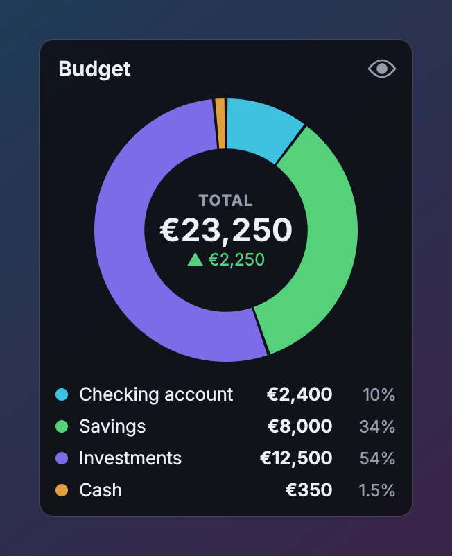

# Budget Pie

   

A small desktop widget that shows where your money sits as a donut chart: one
coloured slice per account (checking, savings, cash, investments…), the total in
the middle, and how it has changed over the last month.

<p align="center"></p>

## Requirements

* Windows 10 or 11
* Python 3.10 or newer on `PATH` ([python.org](https://www.python.org/downloads/))
* [PySide6](https://pypi.org/project/PySide6/) — installed automatically by `run.bat`

## Running it

```
git clone https://github.com/viruztt/BudgetPie.git
cd BudgetPie
run.bat
```

Or download the ZIP from GitHub, extract it, and double-click **`run.bat`**.
The first run creates a `.venv` beside the script, installs PySide6, then
launches with `pythonw` (no console window). A fresh install starts with four
example accounts and example amounts — set your own.

Then run **`install_startup.bat`** once so it starts with Windows.
**`remove_startup.bat`** undoes it. If you move the folder, run
`install_startup.bat` again.

* **`list.bat`** prints every account and the total to a console.
* **`selftest.bat`** checks the maths and the data file.

## Using it

* **Double-click** a slice or a row to type its new amount. Right-click it for
  *Set amount…*, *Add / subtract…* (e.g. +250 after payday), *Edit…*, *Delete…*.
* **Hover** a slice: it lifts out and the middle shows that account's amount
  and share. Hover the middle for assets, debts and the change in detail.
* **Click the middle** (or the eye icon) to **hide amounts**: every figure
  becomes `••••`, the change shows as a percentage, and the slices stay. It's
  remembered across restarts, and the tray icon has the same switch.
* **Edit accounts…** (right-click or tray) opens the list: add, duplicate,
  delete, drag to reorder (the pie follows the order), pick slice colours.
* **Debts**: give an account a negative amount (credit card, loan). It's left
  out of the pie, listed in red, and subtracted — the middle then reads *NET*.
* **Change under the total** compares with the total as it was a month ago
  (*Change compared with* sets a week, 3 months or a year). It needs history,
  so it appears from the second day you use it — each day you change an
  amount, that day's total is recorded.
* **Currency format**: €12,450 by default; *12 450 €*, *12.450 €*, $, £ and ₴
  are in the menu. **Decimals** switches between whole amounts and cents on
  the widget (the editor always shows cents).
* **Drag** the widget anywhere. Let go within 40 px of the left or right edge
  and it docks there; let go elsewhere and it floats. The position is saved.
* **Window layer**: *Always on top*, *Normal*, or *Always at the bottom*. The
  widget has no taskbar button — use **Bring to front** on the tray icon.

Amounts are typed in by you; nothing is connected to a bank.

## From the command line

```
python main.py --list
python main.py --set savings 8250
python main.py --add cash -40
```

The name is case-insensitive and a unique prefix is enough. A running widget
picks the change up within a couple of seconds.

## Where the data lives

`data/accounts.json` next to the app — plain JSON, readable and hand-editable
(the widget reloads when it changes):

```json
{"version": 1,
 "accounts": [
  {"id": "a1b2c3d4", "name": "Savings", "amount": 8000, "color": "#56D07A",
   "note": "", "updated": "2026-10-13"},
  {"id": "e5f6a7b8", "name": "Credit card", "amount": -640, "color": "#D2526E",
   "note": "", "updated": "2026-10-13"}
 ],
 "history": [["2026-09-12", 21000], ["2026-10-13", 23250]]}
```

`history` keeps one total per day you changed something, for three years.
Saves go through a temp file and an atomic rename with one rolling `.bak`,
which is loaded if the main file is ever unreadable. `data/` is in
`.gitignore`, so your figures never end up in a commit. Set `data_path` in
`config.json` to keep the file elsewhere.

## Configuration

`config.json` is written next to `main.py` whenever you change something from
the menu.

| Key | Meaning |
|---|---|
| `dock` | `left` (default), `right`, or `none` for floating |
| `valign` | `top` (default), `center`, `bottom` — until you drag it |
| `title` | The heading; blank hides it (and the eye icon) |
| `pie_size` | Donut diameter in pixels |
| `legend` | The account list under the pie |
| `show_change`, `change_days` | The change under the total, and how far back |
| `private` | Amounts hidden |
| `currency_symbol`, `symbol_after`, `thousands_separator`, `decimal_mark`, `decimals` | Money format |
| `window_layer` | `top`, `normal`, or `bottom` |
| `opacity`, `font_size`, `click_through`, `margin` | Appearance |
| `data_path` | Where the accounts live (blank = `data/accounts.json`) |

## Layout

```
main.py               entry point (--list, --set, --add, --selftest)
run.bat               first-run installer + launcher
install_startup.bat   add/remove the Windows startup shortcut
remove_startup.bat
list.bat              print accounts and the total
selftest.bat          maths + data file check
tools/
  make_screenshot.py  renders docs/screenshot.png from example accounts
budget/
  model.py            totals, slices, money format, history (no Qt)
  store.py            accounts.json, atomic save, reload on change
  config.py           JSON settings
  widget.py           the donut, legend, menus, tray
  editor.py           the accounts dialog
  theme.py            dark Fusion theme for menus and dialogs
```

## License

[MIT](LICENSE)
